<div align="center">


# Rabbit Hole

### One topic. One week. Real understanding.

A weekly learning challenge: pick something you're curious about, say how much time you have each day,<br/>
and get a researched 7‑day plan built for *understanding*, not box‑ticking.

[](https://react.dev)
[](https://www.typescriptlang.org)
[](https://vite.dev)
[](#-on-your-phone)
[](#-deploy-to-vercel)
[](#-development)

[](https://vercel.com/new/clone?repository-url=https%3A%2F%2Fgithub.com%2Fchiranthan-dev%2Frabbit-hole)

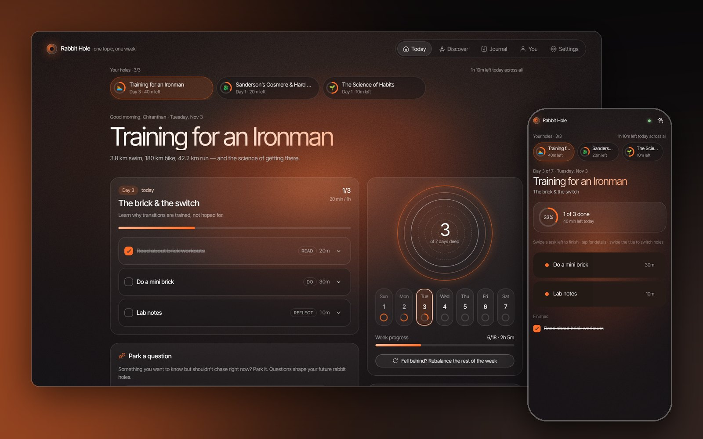

</div>

---

## Contents

- [See it in action](#-see-it-in-action)
- [Why Rabbit Hole](#-why-rabbit-hole)
- [Features](#-features)
- [How it works](#-how-it-works)
- [On your phone](#-on-your-phone)
- [Quick start](#-quick-start)
- [Deploy to Vercel](#-deploy-to-vercel)
- [AI engines](#-ai-engines)
- [Development](#-development)
- [Roadmap](#-roadmap)
- [Credits](#-credits)

## 🎬 See it in action

<div align="center">
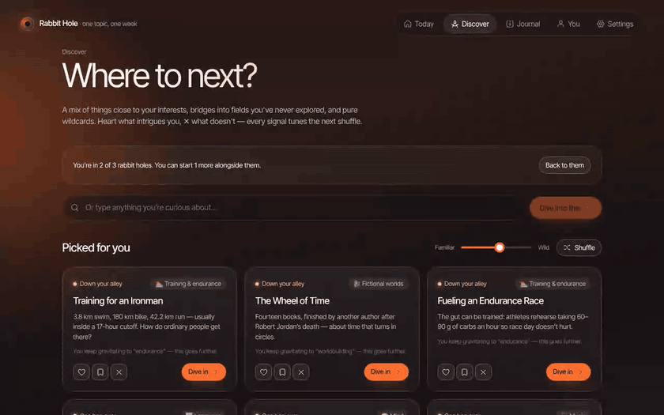
<br/>
<sub>Already in 2 holes → start a 3rd: set your time per day → Claude researches it → paste the plan back → start → tick a task, say how well it clicked → flip between your holes.</sub>
</div>

## 💡 Why Rabbit Hole

Most learning apps reward finishing. Rabbit Hole rewards **getting it**.

- **A week is the right size.** Long enough to go deep, short enough to finish. Then you pick the next hole.
- **Up to 3 at once.** Run an Ironman week next to a fantasy world and a habit, and flip between them in one tap.
- **Your time, respected.** You set the minutes for each day, and the plan always fits. Rest days are allowed.
- **Understanding first.** Every task says *why* it matters and ends with a checkpoint question. Things you mark as fuzzy come back the next day.
- **Curiosity compounds.** The questions you park become future rabbit holes, and the recommender keeps nudging you somewhere you'd never have searched for.

## ✨ Features

<table>
<tr>
<td width="50%" valign="top">

**📅 Today**<br/>
Your day's checklist with a focus timer on every task. The **switcher** at the top flips between up to 3 holes, showing each one's progress and minutes left. After ticking a task, rate it *Fuzzy / Getting it / Clicked* and answer its checkpoint.

</td>
<td width="50%" valign="top">

**🧭 Discover**<br/>
119 hand-picked topics across 20 areas: self-growth, fictional worlds, endurance training, science, history, music and more. Each pick is labelled *Down your alley*, *One hop over* or *Wildcard*, with the reason it was chosen.

</td>
</tr>
<tr>
<td>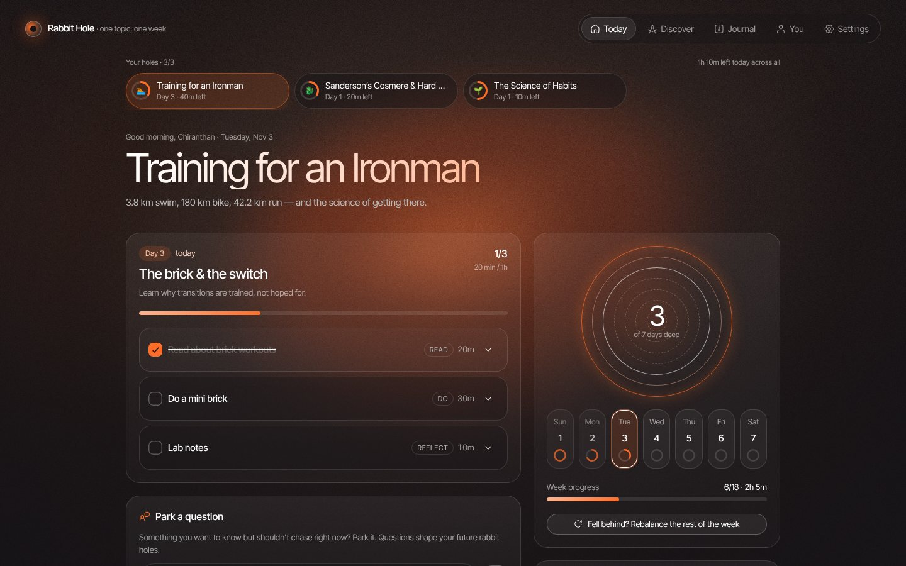</td>
<td>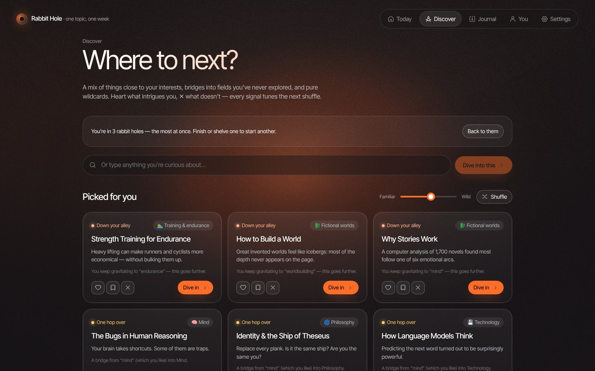</td>
</tr>
<tr>
<td width="50%" valign="top">

**🤖 Let Claude do the research**<br/>
Rabbit Hole writes a prompt with your topic, your angle and your exact minutes for each day. Claude searches the web and sends back the whole week, and you paste it in. You get real sources, with no API keys or costs.

</td>
<td width="50%" valign="top">

**🗺️ The brief**<br/>
The big picture, the key ideas to master (new → fuzzy → clear), guiding questions, common misconceptions, and resources with real links.

</td>
</tr>
<tr>
<td>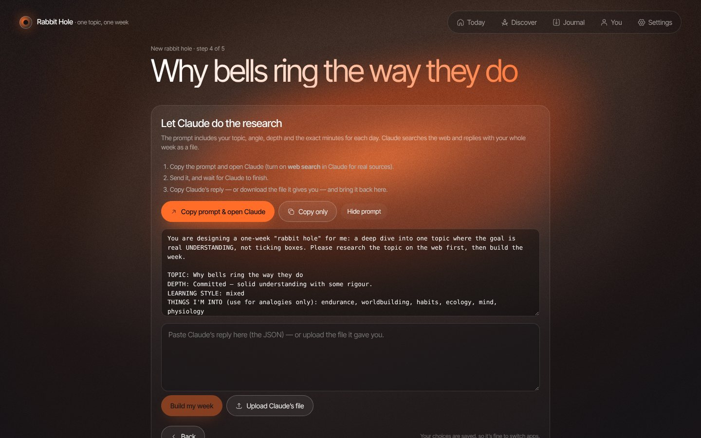</td>
<td>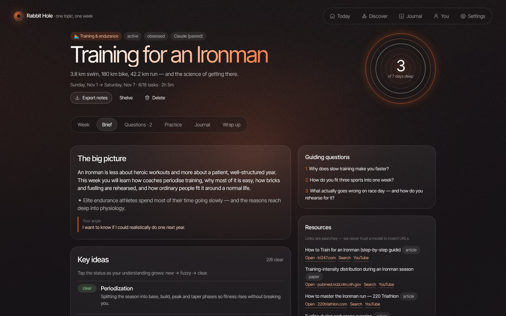</td>
</tr>
<tr>
<td width="50%" valign="top">

**🧠 Practice**<br/>
Quizzes that test understanding rather than trivia, plus a Feynman box: "explain it like I'm 12", with feedback on what you got right and the gaps you missed.

</td>
<td width="50%" valign="top">

**📈 You**<br/>
Stats (streak, time spent, ideas you can explain), your interest map, the themes you gravitate to, and the areas you've never explored.

</td>
</tr>
<tr>
<td>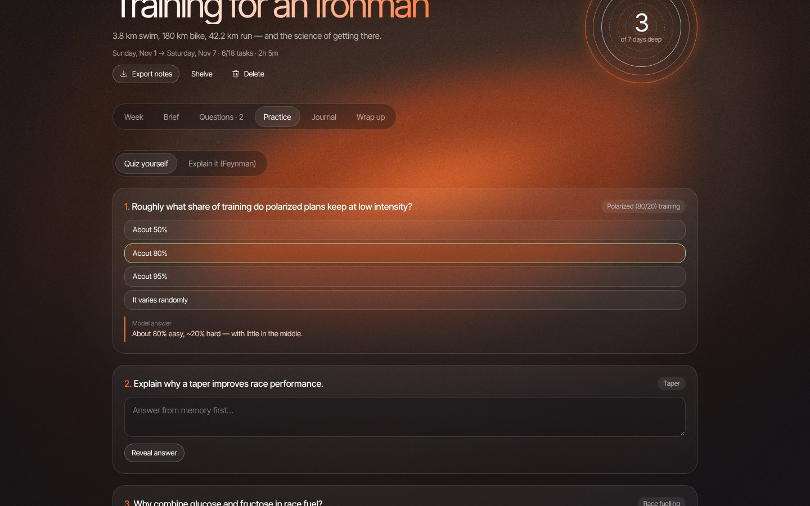</td>
<td>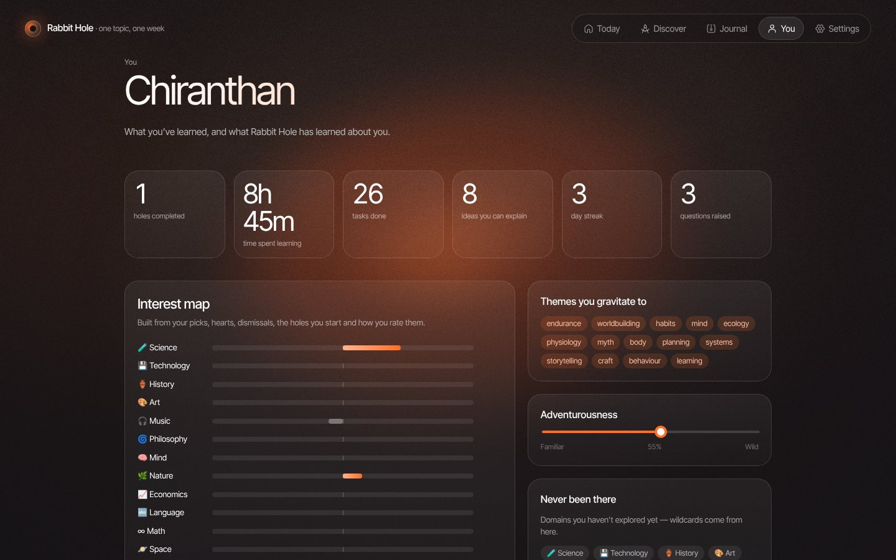</td>
</tr>
<tr>
<td width="50%" valign="top">

**🗓️ The whole week**<br/>
A 7-day arc: *Lay of the land → Foundations → How it works → Hands on → Stories & arguments → Your own tunnel → Teach it back*. Fell behind? **Rebalance** moves unfinished work to days with room, and **Change my time** resizes the rest of the week.

</td>
<td width="50%" valign="top">

**📓 Journal & first-run**<br/>
Every past hole with your wrap-up, rating and the questions it left behind, exportable as Markdown. Onboarding takes about 30 seconds.

</td>
</tr>
<tr>
<td>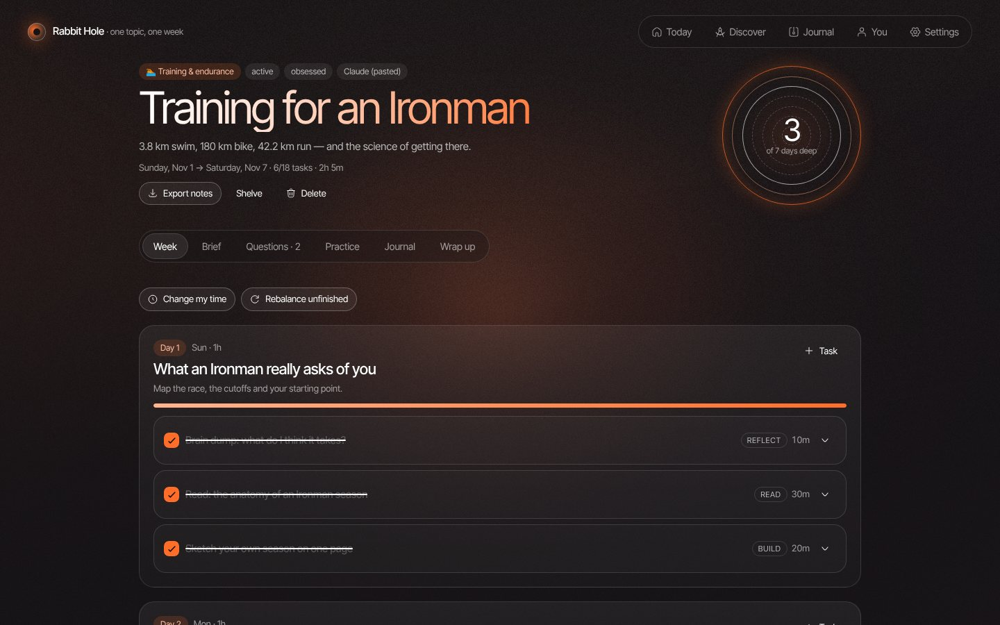</td>
<td>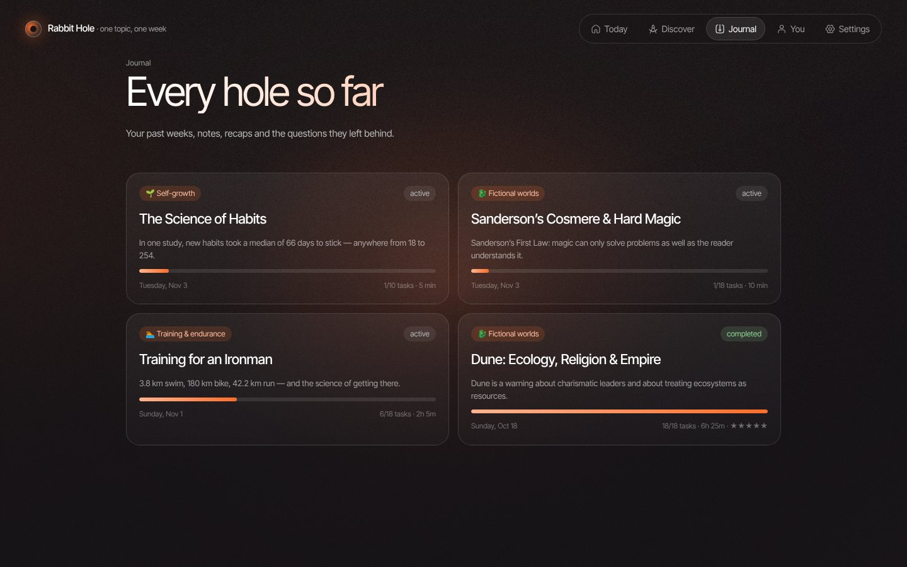</td>
</tr>
</table>

### 🕳️🕳️🕳️ Up to three holes at once

<table>
<tr>
<td width="50%" valign="top">

Be in **up to 3 rabbit holes at the same time**, each with its own week, time budget and progress. The switcher shows how far along each one is today and the total minutes left across all of them.

When you plan a new hole, every day shows the minutes your other holes already need (*"+40m other"*), so the combined week stays realistic. Hit the limit and Rabbit Hole asks you to finish or **shelve** one; shelved holes keep all their notes and can be resumed later.

</td>
<td width="50%" valign="top">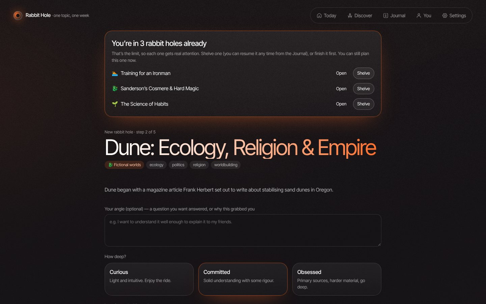</td>
</tr>
</table>

<details>
<summary><b>Everything else in v1</b></summary>

- **Up to 3 rabbit holes at once:** each has its own plan, time budget and progress. While you plan a new one, the wizard shows how many minutes your other holes already take each day, so you don't overload yourself. At 3, you're asked to finish or shelve one first; shelved holes can be resumed from the Journal.
- **Curiosity log:** park questions instead of getting derailed. Ask Claude about them, and turn any of them into next week's hole.
- **Spaced revisits:** marking a task *Fuzzy* adds a 10‑minute revisit to the next day.
- **Wrap-up:** reflect on the week, rate it, hold to close the hole, and get a recap from Claude. Your rating trains the recommender.
- **Replan a day** with AI, **add your own tasks**, **skip** tasks, and keep **end-of-day notes**.
- **Real links only:** Claude's URLs are checked and kept, with search links as a backup. The app never shows model-invented URLs.
- **Backup:** export and import a JSON file. API keys are never included.
- **Look & feel:** animated grain background (or a static one) and a reduced-motion mode.

</details>

## 🔍 How it works

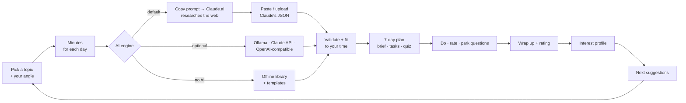

**The recommender** (`src/lib/recommend.ts`) mixes three kinds of picks:

| Kind | How it's chosen |
|---|---|
| **Down your alley** | Highest affinity with the areas and themes you like |
| **One hop over** | A bridge into an area you barely know, through a theme that often appears alongside one you love |
| **Wildcard** | Deliberately far from your profile, favouring areas you've never explored, with seeded randomness |

The **adventurousness** slider sets the mix. It learns from onboarding picks, ♥, saves, ✕ (30‑day cooldown), the holes you start, your final ratings and "go deeper". Topics you've seen a lot fade so new ones come up.

## 📱 On your phone

<div align="center">
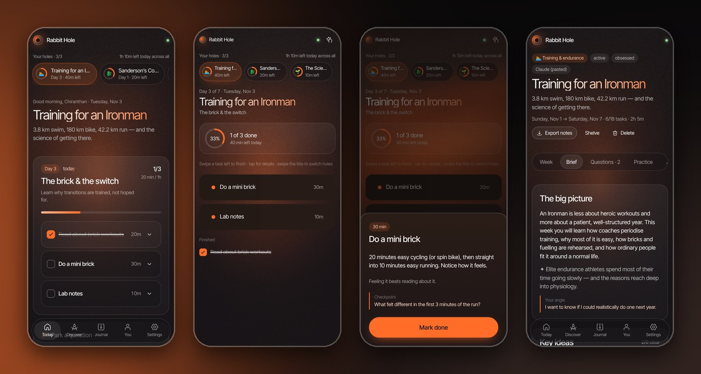
</div>

<table>
<tr>
<td width="320" valign="top">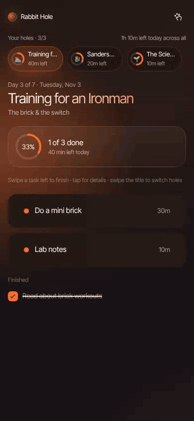</td>
<td valign="top">

**`/m` is the minimal checklist.** It shows just today's tasks: swipe a task left to finish it, tap for its details. Switch holes from the pills at the top, or **swipe the title left/right**.

- **Install it:** open your Vercel link and choose **Add to Home Screen**. It opens straight to the checklist.
- **Sync your laptop and phone:** go to **Settings → Sync across devices → Turn on sync**, then scan the QR code with your phone. There's no account; a private sync code links the devices, and edits merge automatically.

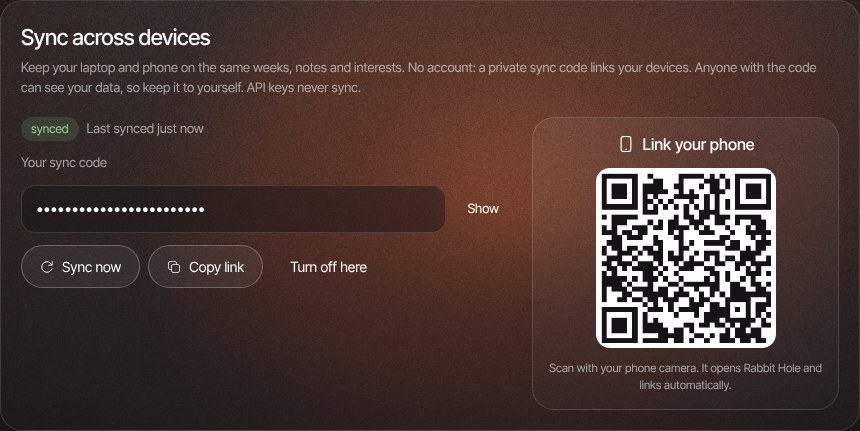

</td>
</tr>
</table>

## 🚀 Quick start

You need **Node 20+**.

```bash
git clone https://github.com/chiranthan-dev/rabbit-hole.git
```

```bash
cd rabbit-hole
```

```bash
npm install
```

```bash
npm run dev
```

Open <http://localhost:5173>. The default engine is **Claude.ai copy & paste**, so nothing else is needed. Sync also works locally, using an in-memory store.

To use a local model instead, run Ollama, then in **Settings** click **Detect local models** and **Test connection**:

```bash
ollama pull qwen2.5:7b
```

## ☁️ Deploy to Vercel

1. Click **Deploy with Vercel** above, or go to <https://vercel.com/new> and import this repo. `vercel.json` already sets the build. Click **Deploy**.
2. **Add the sync database:**
   1. In the project, go to **Storage → Create Database → Upstash (Redis)**. The free plan is enough.
   2. Click **Connect** to this project.
   3. Go to **Deployments → ⋯ → Redeploy**.
3. Open the link on your laptop, turn on sync, scan the QR code on your phone, then **Add to Home Screen**.

One Upstash database can serve several Vercel apps; Rabbit Hole only uses keys that start with `rh:`. Every push to the production branch redeploys automatically.

<details>
<summary><b>How sync works</b></summary>

- `api/sync.ts` is a Vercel Function. It stores one versioned JSON snapshot per **hashed** sync code in Upstash and rejects stale writes (HTTP 409).
- `src/lib/sync.ts` timestamps each section on each device (profile, every hole, saved topics…). On sync it merges section by section: the newest version wins, and deletions are remembered. It pushes on change, on focus and every 45 seconds.
- The sync code is the only key to your data, so keep it private. You can turn sync off on any device. **Erase everything** only clears the device it's run on.

</details>

## 🤖 AI engines

All AI goes through one interface (`src/lib/ai/providers.ts`). Changing engines is a setting, not a code change.

| Engine | Setup | Notes |
|---|---|---|
| **Claude.ai copy & paste** *(default)* | Nothing; uses your Claude account | Best quality with real web sources. One copy-paste per week. |
| **Ollama** | Local only: `ollama pull qwen2.5:7b` | 7B/8B works; Qwen 14B is noticeably better. Can't browse the web. |
| **OpenAI-compatible** | LM Studio, OpenAI, Groq, OpenRouter… | Depends on the model. |
| **Claude API** | Anthropic API key (billed per use) | Automatic, optional live web research. |
| **Offline** | Nothing | Curated library and templates. |

Plans always fit your time. Every reply is checked against a strict JSON schema, broken JSON is repaired or retried, days over budget are trimmed, and any day that still fails falls back to a template.

## 🛠️ Development

| | |
|---|---|
| **Frontend** | React 19, TypeScript, Vite, React Router, Zustand (persisted) |
| **UI** | Custom design system plus [React Bits](https://github.com/DavidHDev/react-bits) components, Hugeicons, Inter Tight |
| **PWA** | `vite-plugin-pwa`; installs and opens to `/m` |
| **Backend** | One Vercel Function and Upstash Redis |
| **Tests** | Vitest (planner, recommender, Claude importer, sync merge and API, multiple holes), plus Playwright walkthroughs |

```bash
npm test
```

```bash
npm run build
```

<details>
<summary><b>Project layout</b></summary>

```
api/
  sync.ts            Vercel Function for sync (Upstash Redis)
src/
  lib/
    catalog.ts       119 curated topics, 20 areas
    planner.ts       learning arc, time fitting, offline planner, rebalance, revisits
    recommend.ts     the interest / serendipity algorithm
    manual.ts        Claude copy & paste: prompts + importer
    create.ts        topic → research → arc → daily tasks (AI with offline fallback)
    ai/              providers (Ollama, OpenAI-compatible, Claude) + prompts & schemas
    store.ts         app state + learning signals
    sync.ts          cross-device change tracking + merge
  pages/             Today, NewHole, Hole, Discover, History, You, Settings, Onboarding, Mobile, LinkDevice
  components/        Shell, TaskItem, HoleSwitcher, ClaudeHandoff, SyncPanel, widgets
  bits/              React Bits components
docs/                README images and GIFs
```

</details>

## 🎨 Design

Built from a brand sheet: ink `#161316`, brown `#453027`, orange `#FF6D29`, grey `#BABABA`, white `#FFFFFF`. Glass pill buttons, a warm grainy gradient with an orange glow, and white-to-orange headlines. **Neue Montreal** is used if it's installed on your device; otherwise the app falls back to Inter Tight.

## 🗺️ Roadmap

- [x] Weekly plans that fit your time, built for understanding
- [x] Claude copy & paste research flow
- [x] Interest-learning recommender with bridges and wildcards
- [x] Phone checklist (PWA) and cross-device sync
- [x] Up to 3 rabbit holes at once, with a switcher on laptop and phone
- [ ] Reminders and notifications
- [ ] Share a finished hole as a public page
- [ ] Streak-friendly home-screen widget

## 🙏 Credits

UI effects come from **[React Bits](https://github.com/DavidHDev/react-bits)** by David Haz: Grainient, SpringCheck, SwipeRow, HoldButton, ThoughtLine, LatticeLoader, ShinyText, CountUp, SpotlightCard and ClickSpark. They're licensed MIT + Commons Clause (see `src/bits/LICENSE-react-bits.md`): fine to use in apps, but the components themselves can't be resold.

<div align="center"><sub>Made by <a href="https://github.com/chiranthan-dev">chiranthan-dev</a></sub></div>
